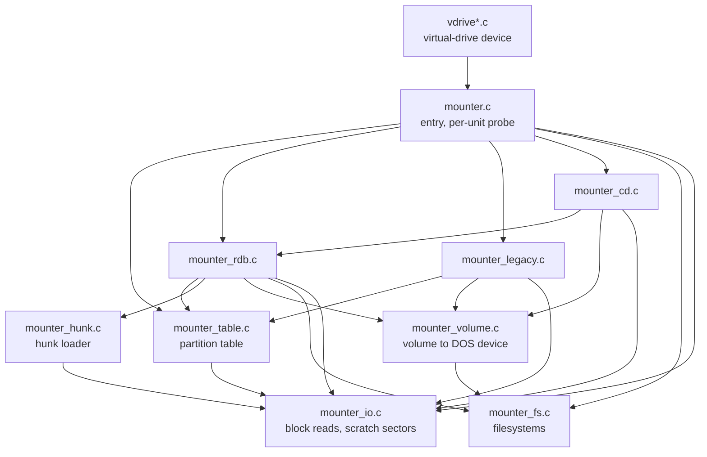
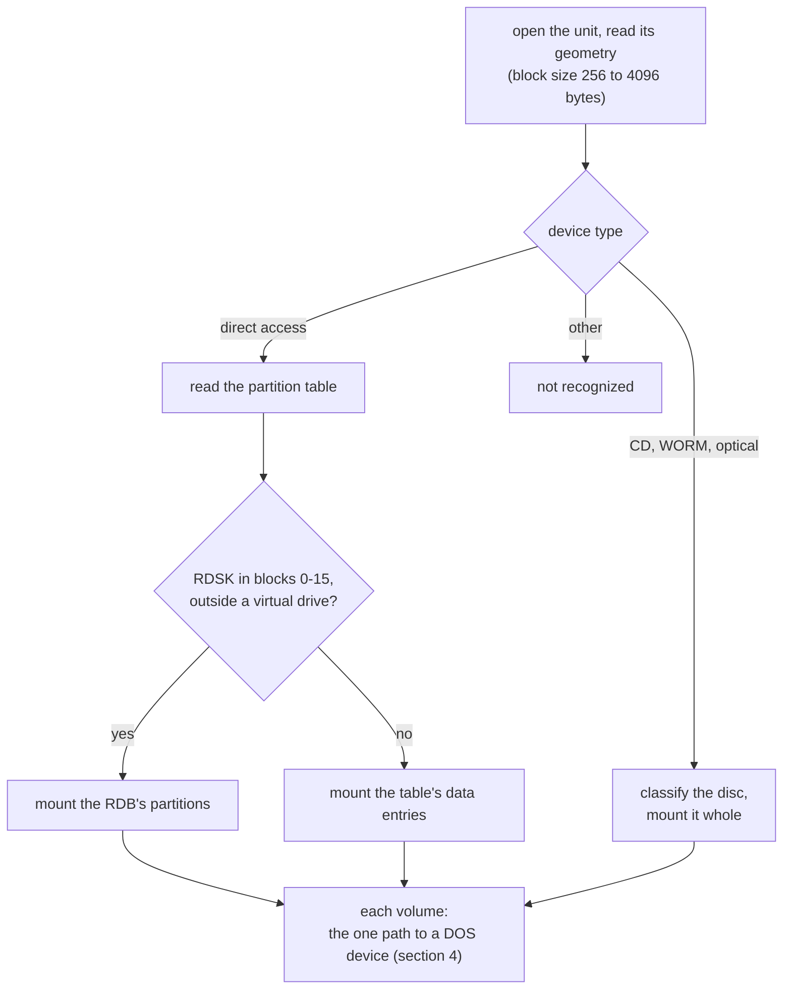
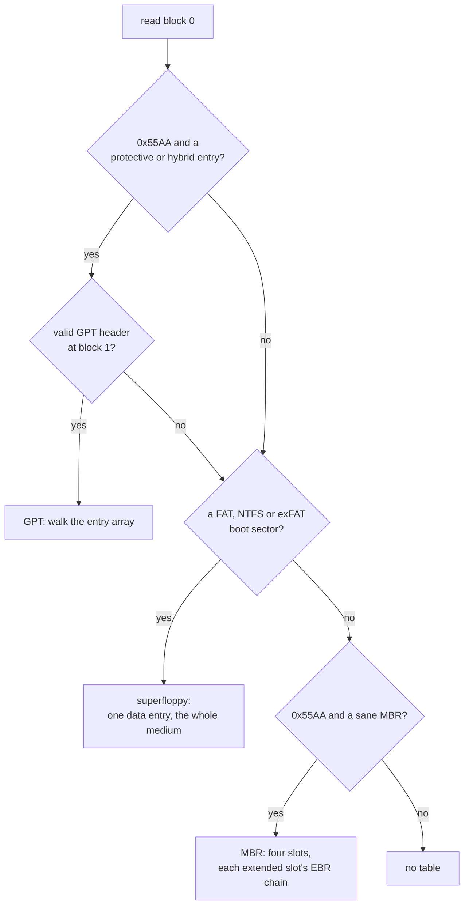
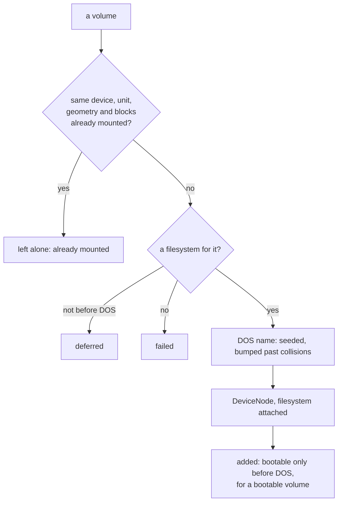
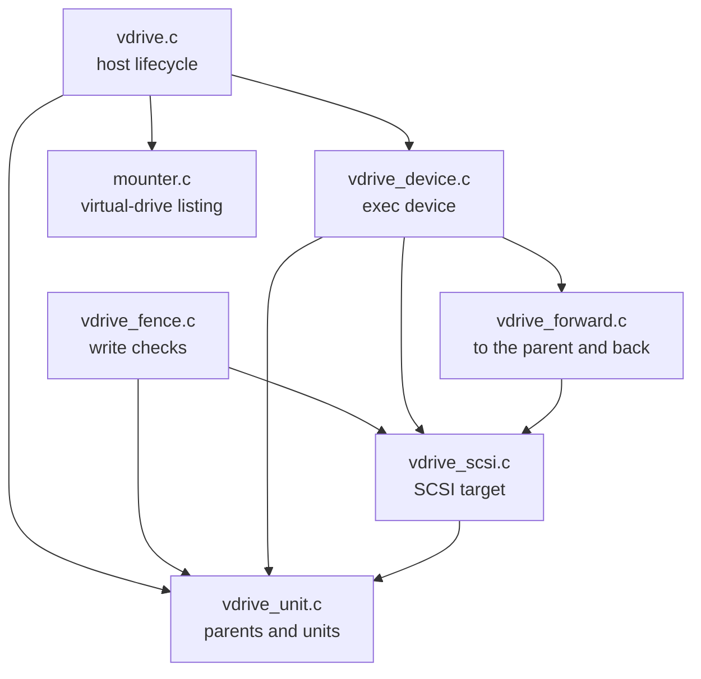

# Mounter architecture

How the mounter works and why, for whoever changes it. What it does for a
driver, and how to call it, is in [README.md](README.md); each source file
opens with what it holds, and each function's contract is its kernel-doc.

## 1. Units

Nine source files, each with one job, and calls that go one way: down. The
virtual-drive device has six more, in section 9.

| Unit | Job |
|---|---|
| `mounter.c` | The two ways in. A mount: the call's setup (recipe defaults, whether DOS exists), then each unit in turn: open, geometry, hand the medium to the scanner for its kind. And the virtual-drive device's listing of one unit's virtual drives, with the same open, geometry and partition table |
| `mounter_rdb.c` | Scanner: the RDSK search, the PART chain, the FSHD chain |
| `mounter_legacy.c` | Scanner: the FAT, NTFS and exFAT volumes of the partition table |
| `mounter_cd.c` | Scanner: CD readiness, table of contents, ISO 9660 descriptor |
| `mounter_table.c` | The partition table: MBR with its EBR chains, GPT, superfloppy |
| `mounter_hunk.c` | Filesystems stored on the disk: the LSEG chain as a stream, and the hunk loader |
| `mounter_volume.c` | The one path from a volume to a DOS device |
| `mounter_fs.c` | `FileSystem.resource`, recipe resolution, attaching a filesystem to a DOS device |
| `mounter_io.c` | Block reads, raw or as checked RDB blocks, and the scratch sectors |

`mounter_internal.h` carries what the units share: the state of one call, the
volume and partition-table types, and one section of prototypes per unit, in
the same order. A function used by one unit only stays `static` in it.

**State.** Everything one call needs lives in one block allocated by the way
in and freed before it returns, in four groups: the call's own
settings (library bases, device, flags, recipes), the unit being scanned (its
request, geometry and partition table), the scratch sectors, and the totals
that become the `MountResult`. There are no writable globals, so the mounter
runs from ROM.

**Scratch sectors.** Every scan step that reads a block borrows a 4 KiB buffer
from a pool of three, allocated on first use and freed when the call returns.
Steps nest, and strictly last-in first-out, at most three deep: an RDSK or
PART block, then an FSHD block, then its LSEG chain; or block 0, then a GPT
header, then its entry array. A plain FAT stick never allocates the deeper
buffers, and an RDB with ten partitions reads them all through the same three.

## 2. One call

`MountDrive()` takes the caller's recipes and fills in the classic FAT and CD
ones the caller left out, so no scanner has to handle a missing recipe. Whether
`dos.library` opens decides, once, whether this is a pre-DOS call: that
choice runs through filesystem resolution (section 5) and booting (section 7).
Then it probes the units in the caller's order, each the same way:

A scanner answers one question, whether it recognized the medium, and the
volumes it mounted are counted on the way through the one path. The unit's
result for the caller (-1 nothing recognized, 0 recognized but nothing mounted,
*n* volumes) is put together in one place from those two. An RDB that sets
`RDBFF_LAST` ends the unit list unless the caller asked otherwise.

**CDs.** Readiness first (spin-up, change state), then the table of contents:
track 1 data or audio. A data disc's ISO 9660 descriptor decides only the boot
priority; which formats a disc may carry is the recipe's call, because only
the handler knows what it can read. A data disc with no descriptor is tried as
an RDB CD. Some enclosures answer the table-of-contents request poorly for DVD
and BD media, exactly where UDF lives, so a recipe that identifies formats
itself gets an unreadable table of contents treated as a data disc.

## 3. The partition table

A direct-access unit's partition table is read once, before anything mounts,
into a table held in the call's state: the scheme (none, MBR, GPT,
superfloppy) and each entry's first block, length and kind. The kind is decided
while reading: data (it may hold FAT, NTFS or exFAT; its boot sector decides
later), virtual drive, or not ours (a GPT type we do not mount, a protective
entry).

- **GPT** is believed only behind a protective or hybrid MBR entry, and only
  with a header that claims block 1, has a sane size and passes its CRC: a
  repartitioned disk often keeps the old header. A valid header commits the
  unit to GPT even when its entry array is refused.
- **A filesystem boot sector ends in 0x55AA too**, so it is recognized before
  the MBR is believed; its fields must also be plausible for its family.
- **An MBR** must look like one: every status byte 0x00 or 0x80, every used
  slot starting inside the medium, at least one used.

Three readers work from the one copy: the RDB scan passes over an RDSK inside
a virtual drive (a virtual drive that starts below block 16 has its RDB where
the parent's could be); the legacy scan mounts the data entries, a superfloppy
being the table's one entry; and the virtual-drive device lists the virtual
drives. Reading the table first, rather than walking it with a callback per
reader, keeps parsing apart from mounting, reads each table once per unit,
and leaves no entry that is valid only while the walk holds its buffers.

## 4. From volume to DOS device

Every scanner ends by describing a volume: an RDB partition brings the
environment vector off the disk and its filesystem already found (section 5);
a CD or MBR/GPT volume names a recipe and its blocks, which map one block to
one "cylinder". One path then turns either into a DOS device, so the duplicate
guard, the filesystem choice, the naming rules and the boot decision each
exist once.

The order is the point. A volume already mounted on an earlier pass, or one
that cannot be mounted, never reaches the naming step, so the `renamed` count
means one thing only: a volume that got a node under a bumped name. When the
naming step ran first, a second pass over a mounted stick renamed `CD0` to
`CD1` and mounted a second handler on the same medium, which surfaced mid-boot
as "Please replace volume".

**The duplicate guard** compares device, unit, block size, geometry and
cylinder range against every node already on the expansion mount list and,
once DOS exists, in the DOS device list. The device name, not the DOS name, is
the identity, so two drives that both want `CD0` are still told apart. A DOS
device's startup field is a `FileSysStartupMsg` only for a filesystem (SER:,
PAR: and PRT: keep a number there), so it is believed only when it, its
device name and its environment vector lie in RAM.

**Names.** A recipe name is shared by every volume of that recipe, so it gets
a unit digit before the collision check; an RDB partition's name is its own
and is taken as it is. A name that cannot grow any further fails the mount
rather than be used unchecked.

## 5. Filesystems

**RDB partitions** look up their dostype in the RDB's FSHD chain. A
filesystem found there is loaded (section 6) and added to
`FileSystem.resource`, unless the resource already has an entry for that
dostype at the same version or newer; failing that, whatever the resource has
for the dostype is used. The check is made again, under `Forbid()`, when the
entry is added: the load in between can take a while, and two drivers loading
the same filesystem from two disks at once must add it once. The copy that
gives way is freed, code and all. Entries are never removed once added, since
DOS devices run the code they point at; the mount path relies on that. A partition whose dostype nothing claims gets no
filesystem attached, which leaves DOS its default, the ROM filesystem.

**Recipe volumes** resolve when they are mounted, in one place:

| Before DOS | After DOS |
|---|---|
| the resource entry, else **deferred** if the recipe has a handler file, else failed | the resource entry, else the handler file if it can be found, else failed. With `MOUNTFS_FORCELOAD` the handler file comes first and the resource entry is the fallback |

A handler file is a promise only DOS can keep. A pre-DOS node carrying one
would hold the DOS name with nothing behind it, and the call after DOS starts
would mount the volume a second time under a bumped name; so before DOS such a
volume is deferred and counted, for the caller to come back. The file check
needs a process (it is a packet), so a task takes the file on trust, with
requesters suppressed so a missing assign cannot stop a hotplug mount.

`FileSystem.resource` is a Kickstart resident from V40 on and is never
fabricated: a second one on the resource list would shadow the real one for
everything mounted later.

A resource entry's `PatchFlags` select which of nine fields go into the DOS
device; the FSHD block, the resource entry and the DOS device hold those nine
in the same order, which is what the flags count, and one copy serves both
directions. The layout is asserted at compile time.

## 6. Filesystems stored on the disk

An FSHD block points at a chain of LSEG blocks holding a hunk-format load
file. The loader reads the chain as a stream of longs and words: each block
holds `lsb_SummedLongs - 5` longs, whatever the block size. A block with no
data ends the load, and so do 65536 blocks read: a chain that links back on
itself would otherwise never end.

It takes a load file without resident library names or overlays: the header,
then every hunk allocated up front with the two longs `LoadSeg()` puts in
front of a segment (its size in bytes, and the link to the next hunk), then
the code, data and BSS contents in order, each followed by its relocations:
`HUNK_RELOC32` in longs, `HUNK_RELOC32SHORT` in words padded to a long, and
`HUNK_DREL32`, which V37 `LoadSeg()` reads like `HUNK_RELOC32SHORT` in a load
file. A relocation at an odd address is applied byte by byte, as a 68000
needs. Name, symbol and debug hunks are skipped, as `LoadSeg()` skips them, and
so is a hunk of an unknown type marked advisory, which V39 treats like a debug
hunk. Memory bits on a hunk's own type are ignored: its memory was decided by
the header. The instruction cache is cleared before the filesystem runs.

## 7. Booting before DOS

Every DOS device goes in through `AddBootNode()`. With a `ConfigDev` the node
is a boot node, a candidate for `strap`; with none, it is what the pre-V36
`AddDosNode()` was, a plain mount. So a `ConfigDev` is passed only before DOS
exists, for a bootable volume, unless the caller said `MSF_NO_BOOT`.

A driver that is not an autoconfig board has no `ConfigDev`, so the first
bootable volume of a pre-DOS call gets a made-up one, shared by the rest of
the call and never freed (the boot node names it for the life of the
machine). It is not added to expansion's board list, where romboot would scan
it for resident modules. Its diagnostic area points at `bootpoint.S`, the boot
entry `strap` calls for a medium without an Amiga boot block: it finds
`dos.library` and jumps to its init.

Only RDB partitions marked bootable, and Amiga-bootable CDs, boot. MBR, GPT
and superfloppy volumes never do: FAT, NTFS and exFAT keep their own boot
sector where an Amiga boot block would be, and offering them only put choices
in the early boot menu that `strap` then skipped.

## 8. Untrusted media

Media arrive corrupt or hostile, and a pre-DOS mount runs with nothing to
catch a crash, so every on-disk field is checked before it is used:

- every RDB block (RDSK, PART, FSHD, LSEG) must carry its ID and a valid
  checksum, with a summed-longs count that covers the header and fits the
  block;
- the environment vector's size and the partition name's length are clamped
  to what their fields hold;
- the PART and FSHD chains are capped (128 and 64 blocks), so a looping link
  cannot hang the caller;
- the hunk loader caps the hunk count (4096), each hunk's size (16 MiB) and
  the LSEG blocks one load reads (65536), and checks every loaded size and
  relocation offset against the allocation;
- MBR and GPT must pass the checks of section 3; a GPT entry must be
  128 × 2^n bytes as UEFI requires, at most 128 entries are read, and an EBR
  chain ends after 16 links or at a link back to its start;
- a partition reaching past 2^32 blocks is skipped rather than truncated.

## 9. The virtual-drive device

A virtual drive holds a whole RDB disk, every block number inside counting
from its own start. Mounting its partitions on the parent unit at shifted
positions does not work: SmartFilesystem records its own position on disk and
refuses a moved volume, and HDToolBox could not edit the inner RDB. So
the host serves each virtual drive as a unit of a separate exec device, built
into its own binary; README.md section 5 is its interface.

**Units.** Six files, with calls again going one way; the only call into the
mounter is the listing of a unit's virtual drives:

| Unit | Job |
|---|---|
| `vdrive.c` | The host's lifecycle calls: a rescan fences a parent's virtual drives and brings their units online, a parent that is gone takes them offline, the device goes when the host expunges |
| `vdrive_fence.c` | The host's write checks on a parent unit |
| `vdrive_device.c` | The exec device: making it, its vectors, the trackdisk commands |
| `vdrive_forward.c` | The requests sent to the parent, and their completion when the host hands them back |
| `vdrive_scsi.c` | The SCSI target behind `HD_SCSICMD`, and the CDB decoder the fence shares |
| `vdrive_unit.c` | Parent records and units: made, looked up, read, freed |

`vdrive_internal.h` carries the records the units share and states the locking
once; `vdrive_scsi.h` lays out the SCSI CDBs, parameter lists and responses as
packed structures, which on a 68k read and write as they are. One lock guards
all the device's state: `Forbid()`, which on a PiStorm costs no access across
the Amiga bus where `Disable()` costs two. It is enough because nothing in the
device runs at interrupt level: rescans, change interrupts, the write checks,
and the requests to the parent, taken in the client's task and handed back in
the host's, are all task code, and so is an abort. A request reads its unit
once, on arrival, into a copy it works from to the end.

**Creation.** The device is made by the first refresh that finds a virtual
drive on any parent, and stays until the host expunges: units and parents are
never freed, only taken online and offline. Each parent unit is opened once,
from the host's task, at its first refresh.

**Forwarding.** A request to a virtual unit is not handed to the parent;
rewriting its device, unit, offset and reply port and restoring them afterwards
would be fragile. The device sends a request of its own: the same buffer and
length, at the virtual drive's offset, always as a 64-bit trackdisk command,
with the device's own port as its reply port. Its requests come from a pool,
four made with the device and more added when that many are in flight, so
there is no allocation per I/O. The trackdisk commands and the SCSI target
both only describe what goes to the parent; one sender sends it, and fails the
request at once when no request of its own can be had. An `AbortIO()` of a
forwarded request is passed on to the parent, which decides: a request still
queued there comes back aborted, one it is executing completes as usual. The
device keeps its requests in flight on a list for this, and for knowing when it
may go.

**Completion.** The host hands every finished request to the device before it
replies it (`VDriveComplete()`), from its own task; the device takes back its
own, recognised by the reply port, and completes the caller's request on the
spot. Nothing else brings them back: the reply port only marks them, and one
the host replied as a message would wait there for good, which the device
logs when it is asked to go. So the device needs neither a task nor an
interrupt, and the whole path runs under `Forbid()`.

**Cost.** Measured on the CM4, a request through the virtual device takes
about 1 µs longer than the same request sent to the parent directly,
whatever its size: a few hundred instructions and two `Forbid()` pairs. The first design completed requests from a software
interrupt on the reply port and took 45 µs: the interrupt's round trip through
the Amiga's interrupt hardware alone is about 30 µs, and every `Disable()` pair
5.6 µs, both being accesses across the Amiga bus on a PiStorm. A task of the
device's own would have cost a task switch, about as much. A write check on a
parent unit costs 0.2–0.3 µs, and nothing at all while no unit has a virtual
drive.

**Answered locally:** geometry, the change count and change interrupts,
`NSCMD_DEVICEQUERY`, and enough of `HD_SCSICMD` for HDToolBox (INQUIRY, READ
CAPACITY, MODE SENSE pages 3 and 4, the READ, WRITE and VERIFY variants as
forwarded requests, SYNCHRONIZE CACHE as an update). The last close of a unit
sends the parent a `CMD_UPDATE`.

**Write protection.** The blocks of a virtual drive with a unit are reachable
two ways, through its unit and through the parent, so on the parent they are
read-only to all but the virtual device; the fence is those units' own block
ranges, at most ten per parent. A virtual drive without a unit, past the ten
slots or too large for one, is reachable through the parent alone and stays
writable there. The host's write paths ask before every write; the device's
own forwarded requests, known by their reply port, pass. The check runs under `Forbid()`,
since a refresh may change the ranges while the parent's I/O task asks. A
medium that cannot be read takes the units offline but keeps the protection:
nothing says the blocks stopped being virtual drives.
